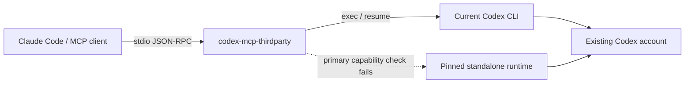

<div align="center">

# codex-mcp-thirdparty

**Bring Codex into Claude Code. Keep the MCP connection independent of Codex updates.**

[](pyproject.toml)
[](pyproject.toml)
[](https://modelcontextprotocol.io/)
[](LICENSE)

**English** · [简体中文](README.zh-CN.md)

[Quick start](#quick-start) · [Tools](#tools) · [Update resilience](#update-resilience) · [Configuration](#configuration) · [Troubleshooting](#troubleshooting)

</div>

An independent MCP server that lets Claude Code start Codex tasks, continue conversations, and inspect runtime health through four tools. It uses your existing Codex CLI installation, login, and model configuration.

OpenAI has [removed `codex mcp-server`](https://learn.chatgpt.com/docs/mcp-server). This project implements its own MCP interface over [`codex exec` and `codex exec resume`](https://learn.chatgpt.com/docs/non-interactive-mode), so the client-facing connection does not depend on that removed command.

Community-maintained software; not affiliated with OpenAI or Anthropic.

## Why use it?

- **Keep familiar tools.** Start with `codex`, continue with `codex-reply`, and recover conversation IDs with `codex-sessions`.
- **Continue across restarts.** Preserve the conversation, project directory, sandbox, and selected model options when Claude or the MCP process restarts.
- **Handle CLI updates.** Detect executable changes, check required capabilities, and fall back to an independently pinned standalone runtime when the primary runtime fails those checks.
- **Run long tasks.** Configurable timeouts, progress notifications, concurrent conversations, and process-group cleanup on cancellation.
- **Use the account you already have.** No additional API key or separate model subscription is required by the bridge. Normal Codex usage limits still apply.
- **Install without a dependency stack.** Python's standard library is the only runtime dependency. The source installer needs neither pip nor npm.

## Quick start

### Prerequisites

- **Linux or WSL2** and **Python 3.10+**. Native Windows is not supported; macOS has not been verified.
- A working **Codex CLI** installation with `codex exec` / `codex exec resume` support and an authenticated account.
- **Claude Code**, or another client that supports MCP over stdio.

Check your Codex installation first:

```bash
codex --version
codex login status
```

### Install and connect

```bash
git clone https://github.com/Lovelymili/codex-mcp-thirdparty.git
cd codex-mcp-thirdparty
python3 install.py

~/.local/bin/codex-mcp-thirdparty doctor
claude mcp get codex
```

Restart Claude Code. The `codex` server should appear as **Connected** in `/mcp`.

The installer copies the server into `~/.local/share/codex-mcp-thirdparty`, creates a launcher in `~/.local/bin`, and registers it as `codex` in `~/.claude.json`. Existing configuration is backed up before replacing that server entry. Other server entries and settings are preserved. The installed copy works independently of the cloned repository.

If `~/.local/bin` is on your `PATH`, you can use `codex-mcp-thirdparty` without the full path. Claude uses an absolute launcher path, so it does not depend on your shell's `PATH`.

### Try it in Claude

> Use Codex to review the project at `/absolute/path/to/project`. Start in read-only mode and explain the most important findings. Keep the thread ID for follow-up work.

For authorized edits:

> Continue that Codex conversation. Use `workspace-write`, fix the issue we agreed on, and run the relevant checks.

### Enable runtime fallback

After a successful Codex task, save your working standalone installation:

```bash
~/.local/bin/codex-mcp-thirdparty pin
```

This is an explicit, local operation. It copies the full standalone distribution, including helper executables and resources, into the bridge's state directory. It does not copy credentials or download another version. **Automatic fallback is available only after a successful pin.**

`pin` currently supports official standalone layouts containing `bin/codex` and `codex-package.json`. Other installation formats can run tasks if capability checks pass, but cannot be pinned by this command.

## How it works



The MCP process owns the client connection. Each task launches Codex as a separate process; prompts travel over stdin, and responses come from JSONL events plus the final-response file. When available, `--no-daemon` avoids coupling these tasks to a shared app-server daemon.

Authentication, model requests, and full conversation history remain managed by Codex.

## Tools

| Tool | What it does |
| --- | --- |
| `codex` | Starts a new conversation and returns its `threadId`, response, runtime information, elapsed time, and usage when available. |
| `codex-reply` | Continues a conversation by `threadId`. Also accepts the legacy `conversationId` field. |
| `codex-status` | Reports runtime compatibility, login status, pinned fallback, configuration locations, and active tasks without a model request. |
| `codex-sessions` | Lists recent bridge conversations so you can recover their IDs. Accepts `limit` from 1 to 100. |

### Start a task

Arguments for `codex`:

```json
{
  "prompt": "Review the request validation logic and explain any defects.",
  "cwd": "/absolute/path/to/project",
  "sandbox": "read-only",
  "timeout_seconds": 600
}
```

### Continue a conversation

Arguments for `codex-reply`; replace the placeholder with the ID returned by `codex`:

```json
{
  "threadId": "<threadId returned by codex>",
  "prompt": "Implement the agreed fix and check it.",
  "sandbox": "workspace-write"
}
```

### Task options

Both task tools accept these options:

| Argument | Purpose | Default |
| --- | --- | --- |
| `prompt` | Task or follow-up instructions. | Required |
| `cwd` | Existing absolute project directory. | Server directory; original directory on replies |
| `sandbox` | `read-only`, `workspace-write`, or explicitly requested `danger-full-access`. | `read-only`; inherited on replies |
| `model` | Codex model override. | Existing Codex configuration; inherited on replies |
| `reasoning_effort` | A reasoning level supported by the selected model. | Existing configuration; inherited on replies |
| `timeout_seconds` | Per-call limit, from 1 to 86,400 seconds. | 3,600 |
| `images` | Local image paths; relative paths resolve against `cwd`. | None |
| `add_dirs` | Additional absolute writable directories for `workspace-write`. | None; inherited on replies |
| `config` | Supported per-call Codex configuration overrides. | Existing configuration; most overrides inherited on replies |
| `approval-policy` | Non-interactive execution policy; only `never` is accepted. | `never` |

`config` accepts `model_reasoning_effort`, `model_reasoning_summary`, `model_verbosity`, `model_context_window`, `model_auto_compact_token_limit`, `service_tier`, `web_search`, and `developer_instructions`. Model-specific values are validated by Codex. Explicit `reasoning_effort` takes precedence over the corresponding `config` value, including a previously saved explicit value.

Replies restore saved options unless overridden. Pass `add_dirs: []` to clear additional writable directories. Local image attachments are supplied per call. Developer instructions are not duplicated into the bridge's metadata files; pass them again when they are needed as a per-call override.

## Update resilience

The bridge and Codex have separate update lifecycles:

1. **Stable MCP entrypoint.** Codex updates do not replace the bridge's installed files or Claude's launcher configuration.
2. **Capability checks before execution.** The bridge detects changes to the resolved executable and checks the required `exec` / `resume` options. Compatible updates are picked up without restarting the bridge.
3. **Independent fallback.** If the primary executable is missing, cannot pass the launch checks, or lacks required options, the bridge tries the pinned copy. Removing the original release directory does not remove that copy.
4. **No automatic task replay.** Once a task starts, failures return to the client. The bridge does not rerun a task that may already have changed files.

The fallback snapshot changes only when you run `pin`. The command checks CLI capabilities; it does not run a model request. Validate a new runtime through a real task before pinning it. Older snapshots are retained for manual recovery and consume disk space.

The initial release was verified with **Codex CLI 0.163.0** and **Claude Code 2.1.309** on Linux/WSL. Capability detection helps with local installation and CLI changes; authentication, model availability, configuration formats, or event protocols can still require maintenance. An older runtime may also be unable to resume a session written by a newer incompatible version.

## Configuration

The installer creates `~/.config/codex-mcp-thirdparty/config.json`:

```json
{
  "codex_command": "/absolute/path/to/codex",
  "default_sandbox": "read-only",
  "timeout_seconds": 3600,
  "max_parallel": 4,
  "progress_interval_seconds": 10
}
```

Use the stable Codex launcher path, not a path inside a numbered release directory. The installer discovers the executable automatically; `--codex /path/to/codex` overrides that choice.

| Setting | Behavior |
| --- | --- |
| `codex_command` | Executable path or command name. The installer normally records an absolute launcher path. |
| `default_sandbox` | Initial sandbox for new conversations. |
| `timeout_seconds` | Default task duration, from 1 to 86,400 seconds. |
| `max_parallel` | Active Codex tasks per MCP process, from 1 to 32. |
| `progress_interval_seconds` | Notification interval, from 1 to 60 seconds, when the client supplies a progress token. |

Environment overrides:

- `CODEX_MCP_CONFIG`: bridge configuration file.
- `CODEX_MCP_STATE_DIR`: logs, session metadata, configuration backups, and pinned runtimes.

The default state directory is `~/.local/state/codex-mcp-thirdparty`. Earlier local installations using `codex-mcp-bridge` retain their existing configuration and state locations when detected. `doctor` reports the locations actually in use. Reconnect or restart the MCP process after changing bridge settings.

### Other MCP clients

Install without changing Claude's configuration:

```bash
python3 install.py --no-register
```

Use this stdio server definition, replacing the executable path with the installed launcher's absolute path:

```json
{
  "mcpServers": {
    "codex": {
      "command": "/home/you/.local/bin/codex-mcp-thirdparty",
      "args": []
    }
  }
}
```

Set the client's tool timeout to exceed the desired task duration. For Claude Code, the installer sets a server-specific 24-hour-plus-one-minute timeout and enables `alwaysLoad` for the four tools. The bridge's own default remains one hour. Other clients may use different timeout and discovery settings.

An optional Python package entrypoint is also available with `python3 -m pip install .` inside an appropriate virtual environment. This installs the command only; it does not register an MCP client. The package has no runtime dependencies, although building it requires setuptools.

## Execution and data

- Tasks default to `read-only`. Use `workspace-write` for authorized edits. `danger-full-access` disables the sandbox and must be selected explicitly.
- Non-interactive calls use `approval_policy="never"`. Operations requiring interactive approval fail instead of waiting for an approval UI. The bridge does not automatically escalate permissions.
- Concurrent replies to the same conversation are blocked by a file lock, including across separate bridge processes. Independent conversations can run concurrently.
- Timeouts, client cancellation, and client disconnects terminate the task's process group. Changes already made remain on disk; inspect them before retrying.
- Prompts use stdin instead of shell interpolation or command-line arguments. The bridge's rotating log records operational metadata rather than prompts or replies.
- Bridge session metadata is stored in private files. Codex maintains its own history and authentication data under its normal rules. Temporary response files are removed after each completed or handled failed call.

## Troubleshooting

| Symptom | What to check |
| --- | --- |
| Claude still launches `codex mcp-server` | Rerun `python3 install.py`, then restart Claude. Check for a project-level `codex` entry overriding the user-level registration. |
| MCP connects, but a task fails | Run `codex-mcp-thirdparty doctor`. MCP connectivity and backend authentication are separate checks. |
| Codex executable is not found | Reinstall with `--codex /absolute/path/to/codex`, or correct `codex_command`. |
| Login is missing or expired | Run `codex login`, then rerun `doctor`. |
| `pin` reports an unsupported layout | Pinning requires the standalone distribution layout. The bridge can still run compatible installations without a pinned fallback. |
| A reply reports an active turn | Wait for the current turn or cancel it from the client. Session locks are released when the owning process exits. |
| A long task ends early | Check both `timeout_seconds` and the MCP client's timeout. Progress notifications do not extend Claude's hard timeout. |
| A task was interrupted | Inspect changes, recover its ID with `codex-sessions`, and continue explicitly with `codex-reply`. |

Diagnostics:

```bash
~/.local/bin/codex-mcp-thirdparty doctor
claude mcp get codex
```

`doctor` does not make a model request. The state directory contains `bridge.log`, with three rotated backups, plus `sessions/`, `runtimes/`, `fallback.json`, and installation backups.

## Updating and uninstalling

Update this bridge from your clone:

```bash
git pull --ff-only
python3 install.py
```

Restart Claude Code to load the installed copy. Existing bridge settings and state are retained. You can update Codex separately; refresh its fallback with `pin` after verifying the new runtime.

To disconnect from Claude:

```bash
claude mcp remove codex -s user
```

Installed files and state are kept for recovery. Remove the launcher and installed source directory manually if you no longer need them; keep session metadata and pinned runtimes until you have finished any ongoing work.

## Contributing

Issues and focused pull requests are welcome. Include your OS, Python/Codex/Claude versions, the command that failed, and redacted diagnostics. See [CONTRIBUTING.md](CONTRIBUTING.md).

## License

[MIT](LICENSE) © Lovelymili. Codex and Claude Code remain subject to their own licenses and service terms.
