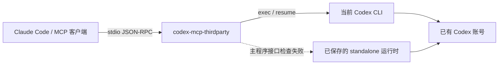

<div align="center">

# codex-mcp-thirdparty

**在 Claude Code 中调用 Codex，让 MCP 连接独立于 Codex 的更新。**

[](pyproject.toml)
[](pyproject.toml)
[](https://modelcontextprotocol.io/)
[](LICENSE)

[English](README.md) · **简体中文**

[快速开始](#快速开始) · [工具](#工具) · [更新兼容机制](#更新兼容机制) · [配置](#配置) · [故障排查](#故障排查)

</div>

一个独立实现的 MCP 服务，通过四个工具，让 Claude Code 发起 Codex 任务、继续对话并检查运行状态。沿用已有的 Codex CLI、登录状态和模型配置。

OpenAI 已[移除 `codex mcp-server`](https://learn.chatgpt.com/docs/mcp-server)。本项目在 [`codex exec` 和 `codex exec resume`](https://learn.chatgpt.com/docs/non-interactive-mode) 之上实现 MCP 接口，因此客户端连接不再依赖被移除的命令。

本项目由社区维护，与 OpenAI、Anthropic 无隶属关系。

## 为什么使用它？

- **熟悉的调用方式。** 用 `codex` 开始任务，用 `codex-reply` 继续对话，用 `codex-sessions` 找回会话 ID。
- **重启后继续工作。** Claude 或 MCP 进程重启后，保留对话、项目目录、沙箱及所选模型参数。
- **应对 CLI 更新。** 检测可执行文件变化、检查必需接口；主程序未通过检查时，回退到独立保存的 standalone 运行时。
- **支持长任务。** 提供可配置超时、进度通知、独立会话并发，以及取消时的进程组清理。
- **复用现有账号。** 服务本身不要求额外 API Key 或独立模型订阅，Codex 原有用量与限额仍然适用。
- **无需额外运行依赖。** 仅使用 Python 标准库，源码安装不需要 pip 或 npm。

## 快速开始

### 环境要求

- **Linux 或 WSL2**，以及 **Python 3.10+**。不支持原生 Windows；macOS 尚未验证。
- 已安装并登录的 **Codex CLI**，支持 `codex exec` 与 `codex exec resume`。
- **Claude Code**，或其他支持 MCP stdio 的客户端。

先确认 Codex 可以正常运行：

```bash
codex --version
codex login status
```

### 安装并连接

```bash
git clone https://github.com/Lovelymili/codex-mcp-thirdparty.git
cd codex-mcp-thirdparty
python3 install.py

~/.local/bin/codex-mcp-thirdparty doctor
claude mcp get codex
```

重启 Claude Code，在 `/mcp` 中应能看到 `codex` 显示为 **Connected**。

安装器会把服务复制到 `~/.local/share/codex-mcp-thirdparty`，在 `~/.local/bin` 创建启动器，并在 `~/.claude.json` 中注册名为 `codex` 的服务。替换该服务条目前会备份现有配置，保留其他 MCP 条目与设置。安装后的程序独立于克隆目录运行。

如果 `~/.local/bin` 已加入 `PATH`，可以直接使用 `codex-mcp-thirdparty` 命令。Claude 使用绝对启动路径，不依赖终端的 `PATH`。

### 在 Claude 中试用

> 用 Codex 审查 `/absolute/path/to/project` 这个项目。先使用只读模式，说明最重要的问题，并保留会话 ID 供后续使用。

需要授权修改时：

> 继续刚才的 Codex 对话，使用 `workspace-write` 修复已经确认的问题，并运行相关检查。

### 启用运行时回退

成功完成一次 Codex 任务后，保存当前可用的 standalone 安装：

```bash
~/.local/bin/codex-mcp-thirdparty pin
```

这是显式执行的本地操作，会把完整 standalone 分发包复制到服务状态目录，包括辅助程序和资源。不会复制凭据，也不会下载其他版本。**成功执行 `pin` 后，才具备自动回退能力。**

目前 `pin` 支持包含 `bin/codex` 与 `codex-package.json` 的官方 standalone 布局。其他安装方式只要通过接口检查，也可以执行任务，但无法用此命令生成回退快照。

## 工作原理



MCP 进程负责维护客户端连接。每个任务单独启动 Codex：提示词通过 stdin 传入，结果来自 JSONL 事件和最终回复文件。版本支持时使用 `--no-daemon`，降低任务对共享 app-server daemon 版本的依赖。

认证、模型请求和完整对话历史仍由 Codex 管理。

## 工具

| 工具 | 功能 |
| --- | --- |
| `codex` | 新建会话，返回 `threadId`、回复、运行版本、耗时，以及可用时的用量信息。 |
| `codex-reply` | 按 `threadId` 继续会话，也兼容旧参数 `conversationId`。 |
| `codex-status` | 检查接口兼容性、登录状态、后备版本、配置位置及运行中的任务，不请求模型。 |
| `codex-sessions` | 列出最近的服务会话，找回会话 ID。支持 `limit`，范围为 1–100。 |

### 开始任务

传给 `codex` 的参数：

```json
{
  "prompt": "审查请求校验逻辑，说明存在的缺陷。",
  "cwd": "/absolute/path/to/project",
  "sandbox": "read-only",
  "timeout_seconds": 600
}
```

### 继续对话

传给 `codex-reply` 的参数；请用 `codex` 返回的真实 ID 替换占位符：

```json
{
  "threadId": "<codex 返回的 threadId>",
  "prompt": "实现已经确认的修复，并进行检查。",
  "sandbox": "workspace-write"
}
```

### 任务参数

两个任务工具均支持以下参数：

| 参数 | 用途 | 默认值 |
| --- | --- | --- |
| `prompt` | 任务要求或追问内容。 | 必填 |
| `cwd` | 已存在的项目绝对路径。 | 服务工作目录；追问继承原目录 |
| `sandbox` | `read-only`、`workspace-write` 或显式指定的 `danger-full-access`。 | `read-only`；追问继承 |
| `model` | 覆盖 Codex 使用的模型。 | 已有 Codex 配置；追问继承 |
| `reasoning_effort` | 所选模型支持的推理强度。 | 已有配置；追问继承 |
| `timeout_seconds` | 单次任务时限，1–86,400 秒。 | 3,600 |
| `images` | 本地图片路径；相对路径以 `cwd` 为基准。 | 无 |
| `add_dirs` | `workspace-write` 模式下的额外可写目录，使用绝对路径。 | 无；追问继承 |
| `config` | 支持的单次 Codex 配置覆盖项。 | 已有配置；多数覆盖项会在追问中继承 |
| `approval-policy` | 非交互执行策略，仅接受 `never`。 | `never` |

`config` 支持 `model_reasoning_effort`、`model_reasoning_summary`、`model_verbosity`、`model_context_window`、`model_auto_compact_token_limit`、`service_tier`、`web_search` 与 `developer_instructions`。具体模型参数值由 Codex 校验。显式设置的 `reasoning_effort` 优先于 `config` 中的同名配置，也包括会话之前保存的显式设置。

追问时继承已保存的选项，显式提供新值即可覆盖。通过 `add_dirs: []` 清空额外可写目录。图片按每次调用单独传入。开发者指令不会重复保存在服务的元数据文件中；需要作为单次覆盖项使用时，请重新传入。

## 更新兼容机制

服务与 Codex 分别更新：

1. **固定 MCP 入口。** Codex 更新不会替换本服务的安装文件，也不会改动 Claude 的启动配置。
2. **执行前检查接口能力。** 检测当前可执行文件的变化，检查 `exec` / `resume` 必需参数。兼容的新版本无需重启服务即可使用。
3. **独立后备版本。** 主程序缺失、启动检查失败或缺少必需参数时，尝试使用已保存的快照。原版本目录被删除，也不影响这份独立副本。
4. **不自动重放任务。** 任务开始后发生错误，会把失败返回客户端，不会自动重新执行可能已经修改文件的任务。

只有运行 `pin` 才会更新后备快照。该命令检查 CLI 接口，不会请求模型；请先用真实任务确认新版本可用，再保存快照。旧快照保留用于人工恢复，并会占用磁盘空间。

首个版本在 Linux/WSL 环境下使用 **Codex CLI 0.163.0** 与 **Claude Code 2.1.309** 验证。接口检测可以应对本地安装与 CLI 变化；认证、模型可用性、配置格式或事件协议变化仍可能需要维护。旧运行时也可能无法继续由不兼容新版写入的会话。

## 配置

安装器会创建 `~/.config/codex-mcp-thirdparty/config.json`：

```json
{
  "codex_command": "/absolute/path/to/codex",
  "default_sandbox": "read-only",
  "timeout_seconds": 3600,
  "max_parallel": 4,
  "progress_interval_seconds": 10
}
```

请使用稳定的 Codex 启动入口，不要填写带版本号的安装目录。安装器会自动发现可执行文件，也可以使用 `--codex /path/to/codex` 指定。

| 配置项 | 含义 |
| --- | --- |
| `codex_command` | 可执行文件路径或命令名，安装器通常记录绝对启动路径。 |
| `default_sandbox` | 新会话的默认沙箱。 |
| `timeout_seconds` | 默认任务时限，1–86,400 秒。 |
| `max_parallel` | 每个 MCP 进程最多同时运行的 Codex 任务数，1–32。 |
| `progress_interval_seconds` | 客户端提供 progress token 时的进度通知间隔，1–60 秒。 |

环境变量覆盖：

- `CODEX_MCP_CONFIG`：服务配置文件路径。
- `CODEX_MCP_STATE_DIR`：日志、会话元数据、配置备份和运行时快照目录。

默认状态目录为 `~/.local/state/codex-mcp-thirdparty`。如果检测到旧版 `codex-mcp-bridge` 本地安装，会沿用已有配置与状态位置。`doctor` 会显示实际使用的路径。修改服务配置后，需要重连或重启 MCP 进程。

### 其他 MCP 客户端

只安装，不修改 Claude 配置：

```bash
python3 install.py --no-register
```

使用以下 stdio 配置，把可执行文件路径替换为实际安装的绝对路径：

```json
{
  "mcpServers": {
    "codex": {
      "command": "/home/you/.local/bin/codex-mcp-thirdparty",
      "args": []
    }
  }
}
```

客户端工具超时应长于预期任务时长。对 Claude Code，安装器会设置此服务专用的 24 小时加 1 分钟超时，并通过 `alwaysLoad` 直接加载四个工具。服务自身的默认任务时限仍为一小时。其他客户端的超时与工具发现配置可能不同。

也可以在合适的虚拟环境中执行 `python3 -m pip install .`，安装 Python 包提供的命令入口。这种方式只安装命令，不会注册 MCP 客户端。包本身无运行依赖，但构建时需要 setuptools。

## 执行与数据

- 默认使用 `read-only`，需要授权修改时使用 `workspace-write`。`danger-full-access` 会关闭沙箱，必须显式选择。
- 非交互调用使用 `approval_policy="never"`。需要交互批准的操作会失败，不会等待不存在的批准界面；服务不会自动提升权限。
- 同一会话的并发追问通过文件锁阻止，跨服务进程同样生效。不同会话可以并发执行。
- 超时、客户端取消或断开连接时，会终止任务进程组。已经发生的修改保留在磁盘上，重试前应先检查。
- 提示词通过 stdin 传递，不进行 shell 插值，也不放入命令行参数。轮转日志记录运行元数据，不记录提示词或回复。
- 服务会话元数据保存为私有文件。Codex 按自身规则管理历史和认证数据。每次正常完成或已处理失败后，临时回复文件会被清理。

## 故障排查

| 现象 | 排查方法 |
| --- | --- |
| Claude 仍启动 `codex mcp-server` | 重新运行 `python3 install.py`，然后重启 Claude。检查项目级 `codex` 配置是否覆盖了用户级注册。 |
| MCP 显示连接成功，但任务失败 | 运行 `codex-mcp-thirdparty doctor`。MCP 连通与后端认证是两个独立检查。 |
| 找不到 Codex 可执行文件 | 使用 `--codex /absolute/path/to/codex` 重新安装，或修正 `codex_command`。 |
| 未登录或登录过期 | 运行 `codex login`，然后重新执行 `doctor`。 |
| `pin` 提示不支持当前布局 | 快照功能要求 standalone 分发包布局；兼容的其他安装方式仍可执行任务，但没有后备快照。 |
| 追问提示会话已有活动任务 | 等待当前任务完成，或通过客户端取消。持锁进程退出时会自动释放锁。 |
| 长任务提前结束 | 同时检查 `timeout_seconds` 与客户端超时。进度通知不会延长 Claude 的绝对超时上限。 |
| 任务被中断 | 先检查已有修改，用 `codex-sessions` 找回 ID，再通过 `codex-reply` 显式继续。 |

诊断命令：

```bash
~/.local/bin/codex-mcp-thirdparty doctor
claude mcp get codex
```

`doctor` 不请求模型。状态目录中包含 `bridge.log` 及三份轮转备份，还有 `sessions/`、`runtimes/`、`fallback.json` 和安装配置备份。

## 更新与卸载

在克隆目录中更新本服务：

```bash
git pull --ff-only
python3 install.py
```

重启 Claude Code 后加载新安装的程序。已有服务配置和状态会保留。Codex 可以单独更新，确认新运行时正常后再使用 `pin` 更新后备快照。

从 Claude 中移除连接：

```bash
claude mcp remove codex -s user
```

安装文件与状态会保留以便恢复。确认不再需要后，可手动移除启动器和服务安装目录；正在进行的工作结束前，请保留会话元数据及运行时快照。

## 参与贡献

欢迎提交 Issue 和范围明确的 Pull Request。请提供操作系统、Python/Codex/Claude 版本、失败的命令，以及已脱敏的诊断信息。详见 [CONTRIBUTING.md](CONTRIBUTING.md)。

## 许可证

[MIT](LICENSE) © Lovelymili。Codex 与 Claude Code 分别适用各自的许可证和服务条款。
